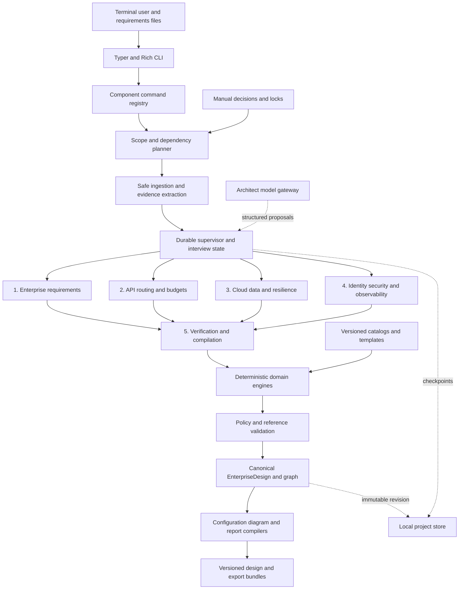
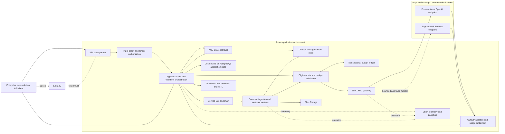
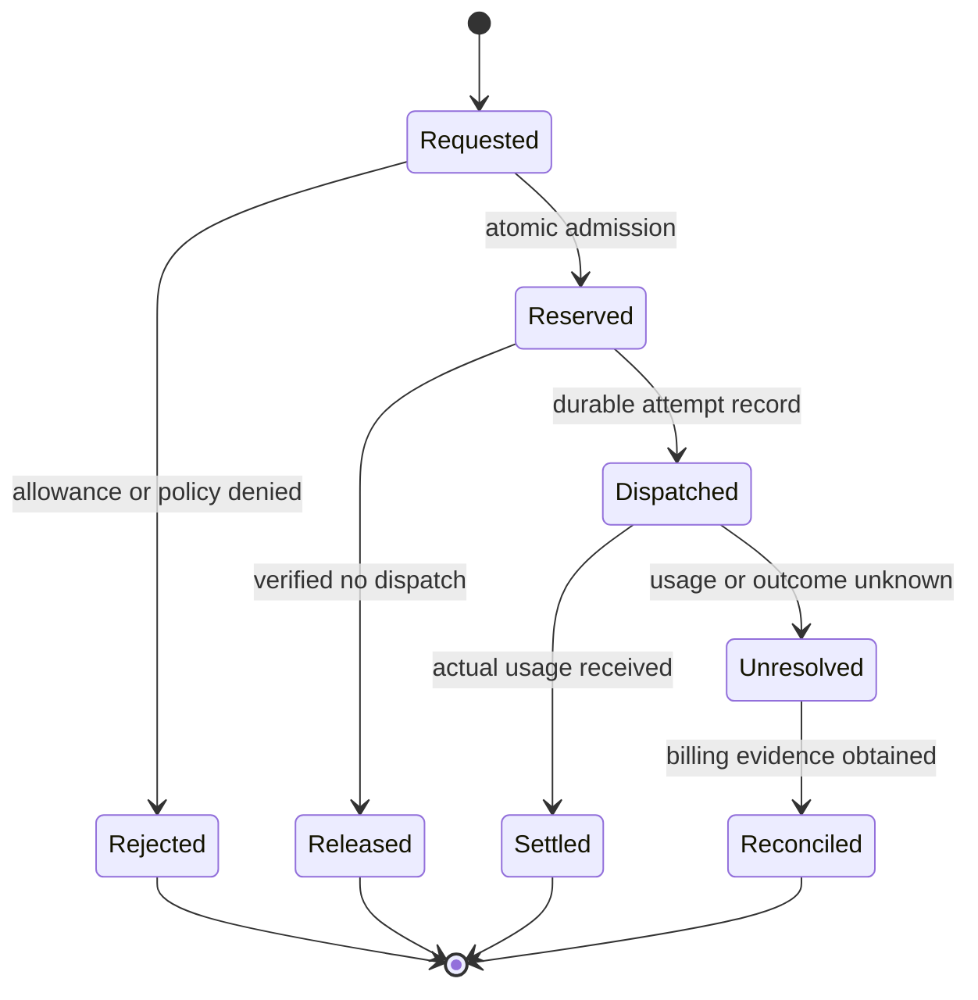

# ArchAI v2 — Application and enterprise system design

Revised 28 October 2026 • Proposed architecture based on both supplied specifications

## What changes

**ArchAI** is the product, **`archai`** is the proposed repository/Python package name, and **`arch`** is the primary CLI command. The app is a terminal enterprise AI solutions architect focused on managed model APIs. It generates requirements, system designs, diagrams, gateway policies, cost/capacity scenarios, cloud configuration, and implementation guidance. Provide `archai` as an executable alias as well; the user's macOS environment already has a system command at `/usr/bin/arch`.

The earlier GPU calculator is replaced in the active workflow by API quota, token, monetary budget, queue capacity, and cloud-service cost engines. The original no-fine-tuning policy stays. Existing GPU work, if any, can remain isolated as legacy code; it is not part of the v2 output.

The app preserves terminal/file input, iterative updates, five specialist roles, typed validation, deterministic Draw.io/Mermaid generation, Markdown/JSON/PDF output, and safe Terraform generation. It adds enterprise identity, API management, model routing, per-department governance, managed data services, and explicit resilience policies.

## Two different systems

**The application being built** is a local Python CLI. Its own dependencies are an architect-model API, local project storage, and optional renderers. It does not need a Kubernetes cluster or enterprise database just to generate a design.

**The system it designs** is the user's enterprise application. That architecture may use APIM/Kong, LiteLLM, Entra ID, AKS/Container Apps/EKS, Service Bus/SQS/Celery, Cosmos DB/PostgreSQL, vector search, and Blob/S3.

This distinction also applies to models: Gemini can power the designer while its output recommends Azure OpenAI and AWS Bedrock. The designer's API bill and the proposed application's API bill are recorded separately.

## Component control: manual and automatic

The command rule is simple: **`arch auto` consumes all requirements and produces the complete AI system design; each component command designs only its own component and produces that component's design document.** A component command can run independently from supplied requirements, without running `arch auto` first, and can reuse existing project context when available.

For example, `arch infra` creates `Infrastructure_Design.md` and requested PDF/configuration outputs; `arch guard` creates `Guardrails_Design.md`; `arch system` creates `System_Design.md` covering system architecture and boundaries. `arch auto` coordinates all applicable components and combines their designs into a consistent `Complete_AI_System_Design` report. The user does not need to run `arch doc` after each component command to receive its document.

```text
arch                        Guided command/component selector
arch auto                   Automatic complete design and documentation

arch requirements           PRD and requirements
arch system                 System architecture and service boundaries
arch api                    APIs and enterprise gateway
arch routing                AI providers, model routes and fallbacks
arch budget                 Token limits and spending controls
arch cache                  Caching strategy and policies
arch workflow               Agents, tools and human approval
arch rag                    Retrieval and grounding pipeline
arch data                   Databases, vectors and storage
arch infra                  Cloud infrastructure and Terraform
arch resilience             Queues, retries, scaling and recovery
arch auth                   Identity, SSO and access control
arch guard                  AI guardrails
arch security               Threat model and security controls
arch observe                Monitoring, traces and alerts
arch eval                   Evaluation and quality strategy
arch cost                   Workload and cost calculations
arch diagram                Architecture diagram views
arch doc                    Design documents and reports
```

Examples of the intended interaction:

```sh
# Design or refine individual parts, using a shared project.
arch system -p support -f requirements.md
arch infra -p support --profile azure-aca
arch guard -p support --mode guided

# Supply exact guardrail settings and protect the resulting decision.
arch edit -p support --component guard --file guard-overrides.yaml
arch lock -p support --component guard

# Complete all remaining applicable designs and documents automatically.
arch auto -p support --answers answers.yaml --formats core

# Automate one component, or render selected documents independently.
arch routing -p support --mode auto
arch doc -p support --scope infra,guard --formats md,pdf
```

**Manual control** includes the scoped interview, typed overrides, reviewable edits, and locked decisions. `arch inspect --component guard` exposes current settings. `arch unlock` explicitly releases a lock. Automatic runs preserve all explicit user choices by default, and never bypass locks when resolving conflicts.

**Automatic control** means `arch auto` schedules all applicable components, runs the necessary specialist roles, checks consistency, and compiles the component documents and consolidated report. It runs unattended with supplied inputs and allowed noncritical defaults. Missing critical information produces a blocked diagnostic. To automate one component alone, use its command, for example `arch infra --mode auto`.

`arch infra` does not redesign APIs or guardrails. It uses existing requirements or collects a standalone workload contract, and asks only for relevant missing inputs. It never requires another component to be generated first when the necessary inputs can be supplied directly. If an infrastructure change affects cost or deployment diagrams, those inherited outputs become stale until refreshed.

`arch doc` and `arch diagram` are optional output controls for rerendering existing state with selected sections/views/templates/formats. They do not change architecture decisions. Partial documents identify missing or stale components. A valid guardrail-only design is not labeled a completed enterprise system. If the `arch design` alias is kept, it means `arch system`, not another complete-design mode.

## 1. Architecture of the designer



The five roles are available within one supervised workflow, with structured handoffs. The diagram shows possible dispatch paths, not a requirement to run every role for each command. The planner selects roles and prerequisites from the component registry; `guard` primarily uses role 4, `infra` role 3, and `routing` role 2. Pure cost recalculation or document rendering uses deterministic engines directly when its inputs are available. The roles may share the same configured model.

Domain code validates proposals and owns numeric results, route eligibility, layout, configuration syntax, and artifact status. Manual changes pass through the same validators as generated changes. A full automatic run orchestrates the same components that individual commands expose; it does not have a separate implementation.

The supervisor uses bounded repair passes. When a conflict cannot be resolved from supplied evidence, it records a blocking diagnostic instead of looping indefinitely or inventing permission.

The internal modules have clear responsibilities:

- `application/` handles the component registry, scope/dependency planner, commands, five roles, checkpoints, and run limits.
- `architect_providers/` handles the designer's model calls and structured output.
- `domain/` implements routing, quotas, budgets, cache policy, cost math, resilience, graph rules, manual decision/lock rules, and cross-reference checks.
- `simulators/` exercises policy and failure scenarios locally.
- `compilers/` translates validated state into supported native configuration and visual/document formats.
- `persistence/` manages inputs, mutable runs, immutable revisions, export bundles, locks, and migrations.

## 2. Example enterprise architecture it generates

This is an Azure-hosted reference with optional cross-provider inference failover. It is a proposed topology, not a deployed service or a mandatory configuration for every project.



The diagram groups inference destinations separately from application hosting. An Azure endpoint can be in the same approved region or another approved region; a Bedrock inference profile can have multiple processing destinations. Endpoint geography must be validated explicitly. A vector store in Qdrant Cloud or Pinecone should appear in its actual external trust/cloud boundary in the generated deployment view, even though the logical diagram above groups data responsibilities together.

**Compute selection:** use Container Apps for the default managed-container profile; use AKS when Kubernetes capabilities or organizational standards require it. EKS is the AWS Kubernetes profile. These are alternatives, not three mandatory layers.

**State selection:** Cosmos DB fits chosen document/session access patterns; PostgreSQL fits relational/transactional patterns. A strict budget ledger needs a documented transactional authority. It can share PostgreSQL with application state when appropriate, or be separate if Cosmos DB hosts the application's document state.

**Gateway selection:** APIM handles the enterprise-facing API; LiteLLM adapts and routes managed AI calls. Give each control an explicit owner. Microsoft documents centralized gateway routing/governance across model deployments, and LiteLLM documents model-group fallback after configured retries. The design adds policy checks around those capabilities. [Microsoft gateway architecture](https://learn.microsoft.com/en-us/azure/architecture/ai-ml/guide/generative-ai-gateway-multiple-models), [LiteLLM fallbacks](https://docs.litellm.ai/docs/proxy/reliability).

## 3. Request processing

A normal RAG request follows these steps:

1. The client signs in and sends an access token. The enterprise gateway validates it and performs request admission.
2. The application derives the tenant, user, and department from trusted identity. It authorizes the task and retrieves only permitted material.
3. The model-admission component filters candidate endpoints by policy, capability, geography, quota, and health.
4. It reserves the required budget for a bounded attempt. A rejected reservation stops the chargeable call.
5. The AI gateway calls the selected provider. Retries/fallbacks stay inside the deadline and total attempt allowance, and each billable attempt needs coverage.
6. The application validates the response, settles reported usage, and returns the result. Unknown usage remains a reconciliation item.

Tool actions pass their own authorization and human approval when required. Switching a model does not authorize rerunning an uncertain refund, message, database mutation, or other external action.

Ingestion and long workflows use a separate job path: accept an authorized job, persist it with an outbox, publish a small reference message, process it in bounded workers, and store status/results. Large document bytes live in object storage. Queue messages are not the sole durable record of business state.

## 4. Rate limits and money budgets

These controls answer different questions:

- Request rate: how many calls can be admitted over a short window?
- Token rate: will this workload exceed an endpoint's allocated processing quota?
- Concurrency: how much work may run simultaneously?
- Spend budget: how much money may this organization/department/user commit over a billing period?
- Workflow limit: how many steps, tool calls, tokens, and seconds can one task consume?

Redis can support fast rate counters. A hard monetary limit additionally needs consistent reservations and durable settlement. LiteLLM offers budget and rate-limit configuration; the stronger reservation/uncertain-charge requirements here are a proposed application contract and must not be claimed as automatic native guarantees. [LiteLLM budgets and limits](https://docs.litellm.ai/docs/proxy/users).



An illustrative invariant: if the remaining authorized allowance is 10 currency units, simultaneous reservations of 7 and 7 must not both succeed. An attempt that times out after dispatch cannot automatically free its reservation, because it may still incur a charge. This is an example of expected behavior, not an assumed provider price.

The cost engine reports baseline, peak, and degraded scenarios using versioned price inputs. It includes repeated attempts, embeddings, cache effects, compute, data services, queues, gateways, telemetry, and egress. Missing prices produce an incomplete subtotal with named gaps.

## 5. Failure behavior

**Provider timeout or transient error:** the designated retry owner applies a bounded policy and circuit-breaker checks; a fallback must still satisfy identity, geography, capability, quality, and budget constraints. Retry and circuit breaking serve different purposes. [Microsoft circuit-breaker pattern](https://learn.microsoft.com/en-us/azure/architecture/patterns/circuit-breaker).

**Stream already started:** report interruption according to the API contract; do not splice a second model's answer into the first stream.

**Worker duplicate delivery:** use idempotent transitions and operation IDs. Failed/poison jobs reach the DLQ with a named recovery owner. Broker support differs across transports; select Azure SDK workers for Service Bus by default and verify any Celery transport separately. [Celery broker capabilities](https://docs.celeryq.dev/en/stable/getting-started/backends-and-brokers/index.html).

**Queue growth:** scale within downstream quota and resource ceilings, apply backpressure, and monitor oldest-message age. Kubernetes needs a queue metrics integration such as KEDA; Container Apps has its own KEDA-backed scaling configuration. [KEDA Service Bus scaler](https://keda.sh/docs/2.18/scalers/azure-service-bus/), [Container Apps scaling](https://learn.microsoft.com/en-us/azure/container-apps/scale-app).

**Primary AI provider failure:** approved secondary inference may continue while the Azure application remains healthy.

**Azure application failure:** AWS Bedrock availability alone cannot restore ingress, application code, databases, queues, or identity dependencies. Full application DR requires a separate recovery environment, data strategy, budget authority, traffic switch, and tested runbook.

**Residency constraint:** inspect all permitted processing destinations, including cross-region inference profiles; the endpoint's source region alone is insufficient. [Bedrock cross-region inference](https://docs.aws.amazon.com/bedrock/latest/userguide/cross-region-inference.html).

## 6. Outputs and support levels

Each design has canonical `enterprise_design.json`, a graph, evidence, policies, capacity/cost results, cloud BOM, risks, and a validation report. Every presentation format derives from this state.

For a scoped design, canonical state contains only defined modules and typed external dependency contracts. The manifest records scope, user choices, locks, and each component's `missing`, `draft`, `valid`, `stale`, `blocked`, or `not_applicable` state. Full strict validation and scoped validation are separate operations. A component can be valid while the project remains incomplete.

The full bundle includes Markdown, JSON, YAML, Mermaid, Draw.io, SVG, PNG, PDF, and applicable Terraform/native workload files. Missing renderer dependencies are reported as failed requested exports; core artifacts are retained. Cloud-agnostic mode marks provider-specific Terraform inapplicable with a reason.

Native APIM policy XML and LiteLLM YAML are mandatory tested compilers. Kong/APISIX can be documented alternatives, but they must remain labeled design-only until native renderers are implemented and validated. A custom strict-budget service is emitted as a contract and local simulator; a config file does not implement its target production service.

Terraform is organized by environment and cloud with explicit prerequisites. User application images, account-owned networks, endpoint entitlements, and approved quotas are supplied by the user. Syntax validation does not demonstrate deployment success.

## 7. History and updates

```text
Input sources -> mutable run/interview/checkpoints -> immutable design revision
                                                       |
                                                       +-> export bundle A
                                                       +-> export bundle B
New requirements -> new run -> new design revision -> new export bundle
```

Stable component IDs support semantic differences between revisions. A change such as “only EU processing” invalidates affected provider routes, data choices, telemetry destinations, capacity calculations, and configuration exports.

Manual edits, component generation, and full automatic runs all create new revisions. The write set is checked against component ownership and decision locks. Keep latest accepted partial and latest complete revision references separately. Preserve unchanged component values; only their dependency status may change when upstream assumptions change.

Export bundles are separate from immutable design revisions. This allows rerendering the same design without rewriting history. Each bundle records design hash, catalogs/templates/tools, artifact hashes, and validation status.

## 8. Build sequence and completion criteria

1. Build ArchAI's CLI entrypoints, component registry, schemas, evidence model, resumable interview, architect-provider adapter, and local state store.
2. Integrate scoped planning, manual overrides/locks, the five roles, canonical design, domain validators, cost/quota math, and policy simulators.
3. Add native gateway compilers and tested Azure/AWS deployment profiles.
4. Add graph layout, diagrams, full report export, updates, and diffs.
5. Verify installed packaging, all CLI paths, error cases, policy invariants, template checks, and representative rendered artifacts.

The defining acceptance case is an enterprise RAG design that can be created from a file, updated with departmental budgets and EU restrictions, simulated through a provider failure, validated, and exported consistently into every requested format. The tool must identify any custom implementation prerequisites instead of presenting the generated target system as already running.

Also verify manual-to-automatic continuity: create a system design, generate infrastructure alone, manually set and lock guardrails, run automatic completion, and confirm those guardrail decisions remain intact in both canonical state and final documents. An incompatible automatic proposal must produce a conflict rather than change the protected decision.

Use [BUILD_PROMPT.md](BUILD_PROMPT.md) as the implementation contract.
