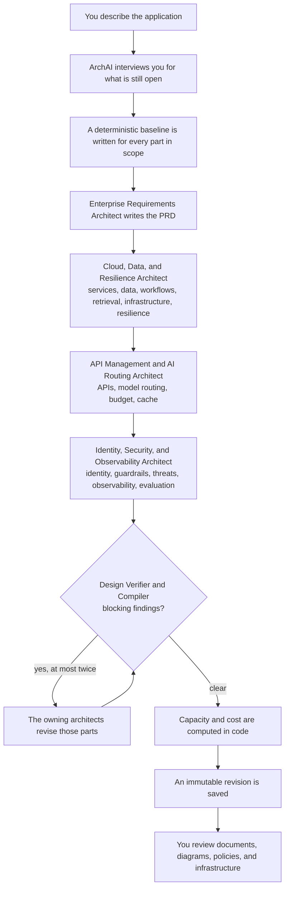

# How ArchAI Turns an Idea into an Enterprise AI Architecture

*Version 1.0.0. Five specialist agents, one supervisor, and a human who still reviews every design. This is the initial phase of the product.*

---

A team wants an internal support copilot. Answers have to come from the company knowledge base. A refund may happen only after a finance approver accepts that exact action. Customer data stays in Europe. There is a hard monthly ceiling on model spend.

Two weeks later the whiteboard has a chatbot, an arrow labeled "LLM," and a vector database someone saw in a blog post. The questions that actually decide the architecture never got a durable answer: who may call which API, which service owns a retry, where the budget ledger lives, what happens when the provider returns 429, which hop is allowed to leave the region.

That gap is what ArchAI is for.

ArchAI is a terminal architect for enterprise AI applications. You describe the product, or you hand it an `idea.md` or a YAML requirements file. It interviews you for whatever is still missing. A team of five specialist roles then designs only the parts that belong to this application, writes an immutable revision, and exports documents, diagrams, policies, and infrastructure you can open and review.

ArchAI writes that design. You review it. You decide what gets built, and you apply infrastructure in your own pipeline. ArchAI never deploys.

---

## What it solves when the work is real

Enterprise AI systems fail in the seams, long after the demo.

The demo is a prompt and a model. The production system is a set of decisions that have to agree with each other:

- Who uses it, and which roles may call which operation.
- Whether the model may change another system, and whether a person must approve the exact action.
- Where prompts, documents, and embeddings may be processed.
- How traffic, tokens, and a hard monthly budget become routing, reservations, and a scale starting point.
- What happens on timeout, rate limit, or a fallback provider.
- Which threats you are designing for, how you will observe them, and how you will evaluate both the primary route and the fallback before a release.

Those decisions usually live in a PRD, a slide, a Terraform sketch, and someone's memory. They drift. A retrieval pipeline shows up in an app with no documents. A response cache shows up on a batch job with no users. RBAC shows up because the template had RBAC.

ArchAI keeps one design record. Parts that do not fit are left out. Saying `cache excluded`, `I don't need RBAC`, or `deployment excluded` removes that part. The core stays: services, APIs, model routing, budget, data, and security. An excluded component is still listed. Its document says it is not applicable, and why, so the omission is a decision.

What you get is a reviewed design input.

- Cost output is a scenario from the numbers you supplied. It is not a vendor quotation. Missing prices stay unknown.
- Terraform and Kubernetes manifests are generated for `azure-aca`, `azure-aks`, and `aws-eks`. They are not applied, planned, or checked against your account, region, quota, or SKU. Run `terraform validate` and `terraform plan` yourself if you take them further.
- Deployment IDs are `USER_SUPPLIED` placeholders.
- The packaged catalogs, including OWASP Top 10 for LLM Applications 2025 identifiers, are snapshots used by the threat model. They are not a compliance claim.
- Budget reservation, object-level authorization, approval binding, and provider eligibility filtering are application work. They are listed in `config/integration_contracts.md` for the engineers who build them.

---

## How it makes you think like an architect

An architect's first job is to refuse a vague sentence.

"Build a copilot" does not decide residency, tenancy, identity, tool side effects, or a monthly ceiling. On a terminal, ArchAI asks. The interview is a typed question bank. The same bank tells a non-interactive run which answers are still missing, by question ID.

You stay in control of the conversation:

- Enter, or `none`, accepts the best fit from what has already been collected. On the optional-parts question, `none` keeps every optional part.
- `skip` leaves an optional question blank.
- `back` returns to the previous question.
- `?` shows help.
- `save` stops and keeps the answers. `archai resume` continues that run.
- A review table appears before the design team starts. Type a row number to change an answer.

The questions are the ones a solutions architect asks in the first working session.

**Business and users.** Describe the AI application: what it does and for whom. What outcome must this achieve? Who uses it? Which roles or permission levels exist? Which channels call it: web, mobile, Microsoft Teams, Slack, a public API, an internal API?

**Workload.** Which patterns apply?

- enterprise RAG
- tool-using agent
- enterprise copilot
- multimodal documents
- text-to-SQL
- realtime voice
- summarization
- classification and extraction
- hybrid integration

May tools change external systems? The answer is `forbidden` (read-only), `approval` (a human approves each exact action), or `allowed` (autonomous within authorization). Which business systems are integrated? Which knowledge sources feed retrieval, and roughly how many documents are ingested per day?

**What to leave out.** Cache, RBAC, cloud deployment, retrieval, observability, evaluation, workflows, guardrails, resilience. Phrases that work on the related question: `cache excluded`, `I don't need RBAC`, `deployment excluded`, `not required`, `retrieval excluded`.

**Traffic.** Average and peak requests per second. Input and output tokens per model call. Model calls per user request. A team of about 200 people chatting is often 0.5–2 requests per second. One request per second is about 86,400 requests a day. A RAG prompt with a few retrieved chunks is often 1,500–4,000 input tokens. Chat answers are often 300–800 output tokens. A simple chat is one model call. Agents and query rewriting are often two to four. Those numbers later drive capacity, budget, and replica bounds.

**Providers and place.** Which managed model providers are allowed: Azure OpenAI, AWS Bedrock, OpenAI, Anthropic, Google Vertex AI. Topology: one provider, failover to another approved provider, or a full secondary application environment. Region and data-residency list. Tenant isolation. Identity provider (Entra ID, Okta, Auth0, Amazon Cognito, Keycloak, Google Workspace, or another you name). Data classification. The compliance regimes you are designing toward, such as GDPR, SOC 2, ISO 27001, HIPAA, PCI DSS, or the EU AI Act. Availability, latency, recovery time, recovery point. The hard monthly budget and a three-letter currency.

A design that has not named a region, a budget, and whether a refund needs a human is a sketch. ArchAI can still produce that sketch with `--offline`: no model calls, no bill, and the documents say they came from the deterministic baseline. The design you review with a team comes from a configured provider.

Describe the application in concrete terms. Who uses it. What it must do. What it must not do. Where data may live. The monthly limit. Press Enter when the suggested answer fits. Correct the review table when it does not. One vague sentence produces a generic design.

---

## How a design gets decided

`arch auto` runs the full process and creates the complete applicable design. A component command, on a new project, asks the same opening description and the same critical interview, then designs only that component. The saved revision is partial until the other components are saved. Both follow the same decision path. The difference is the scope.



### 1. You feed the problem

Inputs merge into one requirements draft:

- A Markdown or text file, such as `idea.md`. If the file is not JSON or YAML, the whole file is the idea.
- A YAML or JSON file, such as `requirements.yaml`, with structured fields: idea, business outcome, users, archetypes, region, residency, traffic, tokens, budget, providers, hosting profile, topology.
- `-i` / `--idea` for a sentence on the command line.
- `--answers` for a file of answers.
- Standard input.
- Flags such as `--profile` and `--topology`.

If two sources disagree on the same field, that conflict blocks the design until you resolve it. Prose is sent to the Enterprise Requirements Architect, which suggests answers and writes a few clarifying questions. The interview then asks for anything still open.

In a script, `--non-interactive` expects the critical answers to already be in the file. If they are not, the command exits with code 2 and prints the missing question IDs, plus a run ID. `archai resume PROJECT --run RUN_ID` continues from the saved interview.

Critical answers include the idea, the business outcome, users, archetypes, region, data residency, tenant isolation, allowed model providers, tool side effects, average and peak request rate, input and output tokens, model calls per request, monthly budget, currency, and availability target.

### 2. A baseline exists before any specialist rewrites it

ArchAI builds a deterministic baseline for every component in scope. The model proposes changes on top of that shape. If a provider fails and no other provider is configured, the baseline remains, the run records a warning, and the component's **Designed by** line says so.

### 3. The supervisor runs the specialist team

Five roles. One shared budget for the run: 16 generation calls and 400,000 tokens by default (`ARCHAI_MAX_GENERATION_CALLS`, `ARCHAI_MAX_GENERATION_TOKENS`). Each role returns structured output limited to the components it owns. `arch infra` asks the cloud role for infrastructure fields alone.

A Python merger then normalizes IDs, drops references to things that do not exist, and clamps values into legal ranges. The models propose. The program keeps the design consistent.

### 4. A verifier cross-checks the merge

The Design Verifier reads the merged design and the deterministic diagnostics. Blocking findings go back to the role that owns the affected component. That revision loop runs at most twice. Findings that are still blocking stay on the revision as warnings. They are not dropped to make the export look clean.

### 5. Numbers, locks, and a revision you can diff

Capacity and cost are computed in code from your inputs. That step does not call a model. Policy invariants run again. Components you have locked are preserved. The accepted design is stored as revision `0001`, then `0002`, and so on, under `revisions/`. `archai diff` shows what changed between two revisions. A later `arch auto` or `archai export` refreshes the project folder in place. Locked parts are not overwritten.

The request path in the documents is compiled from the saved API contracts, identity, retrieval, budget, and routes. An interactive app uses the streaming chat contract. A scheduler-only batch app uses a jobs contract. A read-only FAQ does not gain a jobs worker. Identity hops appear when an identity provider is selected. Cache trust-boundary rows appear when cache is in the revision. Sprint goals name only components that are actually on the revision.

Replica minimums and maximums in the scale table are the same numbers written into the generated autoscalers. The ceiling is the peak worker estimate times three, clamped between 3 and 30. It is a load-test starting point. Provider quotas still bound model throughput.

---

## How to use it

You need Python 3.12 or newer.

```sh
python3.12 -m venv .venv
. .venv/bin/activate
python -m pip install -e '.[dev]'
hash -r
archai --version
```

The command is `arch`. `archai` is the same program. On macOS, `/usr/bin/arch` already exists, so use `archai` when your shell still finds the system command.

### Point it at a model

Do this once, before `arch auto`. Without an API key, ArchAI still runs, on the deterministic baseline only, and every document says so.

```sh
archai setup
```

The wizard asks for a provider, a model ID, and an API key. The key is hidden while you type and is saved to `./.env` with mode `600`. Add `--global` to write `~/.config/archai/.env` instead. It can also ask for a second provider to use as the Design Verifier.

Settings are read from the shell, then `~/.config/archai/.env`, then `./.env` in the directory where you run the command. A variable already set in the shell wins.

Check the setup. These commands never print the key:

```sh
archai doctor
archai model show
```

Supported providers are OpenAI, Anthropic, Gemini, and DeepSeek. Use a model ID that supports structured output. Your provider bills the calls.

Roles can use different models. The usual split is one model drafting and another provider checking:

```sh
archai model use anthropic claude-sonnet-5-5 --role verifier --key
```

Roles you can bind are `requirements`, `cloud`, `api`, `security`, and `verifier`. If a provider hits quota, a rate limit, or a bad key, and another provider has a key, that role moves to the other provider for the rest of the run.

### Start from idea.md

Create `idea.md`:

```markdown
Build an enterprise support copilot for internal agents.
Answers must be grounded in the knowledge base.
Refunds require a finance approver before anything is sent.
Process data only in West Europe and North Europe.
Identity is Entra ID. Tenants must be isolated.
Hard monthly model budget: 25000 EUR.
```

```sh
archai auto -p support -f idea.md
```

ArchAI reads the file as the idea, sends it for requirements analysis, and interviews you for traffic, providers, residency details, and anything else the prose did not decide. You can also pass the idea inline:

```sh
archai auto -p support -i "Internal support copilot with grounded answers and approved refunds"
```

### Start from a YAML file

When you already know the structured answers, put them in YAML (or JSON). This is the same shape as the packaged Azure enterprise RAG example: users, archetypes, region, residency, identity, tool policy, traffic, tokens, budget, hosting profile, and topology.

```yaml
idea: Build an enterprise support copilot with grounded answers and approved refund actions.
business_outcome: Reduce support resolution time while preserving tenant and document permissions.
users:
  - Support agents
  - Finance approvers
archetypes:
  - enterprise-rag
  - tool-using-agent
region: westeurope
data_residency:
  - westeurope
  - northeurope
tenant_isolation: multi
identity_provider: Entra ID
allowed_target_providers:
  - Azure OpenAI
  - AWS Bedrock
tool_side_effects: approval
avg_rps: 2
peak_rps: 8
input_tokens: 1800
output_tokens: 500
model_calls_per_request: 1.2
monthly_budget: 25000
currency: EUR
availability_target: 99.9
profile: azure-aca
topology: provider-failover
```

A file that already contains the critical answers can run with no prompts:

```sh
archai auto -p eu-support -f requirements.yaml --non-interactive
```

A file that answers only part of the interview still works. ArchAI asks for the rest:

```sh
archai auto -p notes -f requirements.yaml
```

Other useful switches:

```sh
archai auto -p notes -f requirements.yaml --dry-run
archai auto -p sketch -f requirements.yaml --offline --non-interactive
```

`--dry-run` shows the plan without writing files or calling a model. `--offline` is the no-bill sketch. It is useful. It is not the design to review with a team.

### What arch auto does on a terminal

1. Asks for the project name and a description, unless you passed `-p`, `-i`, `-f`, or `--answers`.
2. Sends that description to the Enterprise Requirements Architect.
3. Interviews you, then shows the review table.
4. Runs the design team and shows a live status board.
5. Saves the next immutable revision and prints the project folder, for example `output/support/`.

Open these three first:

1. `documents/High_Level_Design.pdf` — what the system is. Context, tools, request path, trust boundaries.
2. `documents/Low_Level_Design.pdf` — how each hop is implemented. Owner, interface, payload, failure.
3. `documents/Master_Design.pdf` — features, service build order, and four sprint slices: foundation, core path, controls, operate. Sprints are build slices, not calendar dates.

Per-component chapters live in `documents/components/`. Mermaid sources live in `diagrams/mermaid/` (`.mmd` only; PNG, SVG, and draw.io are not generated). Policies and gateway config live under `config/`. Terraform, when the profile has it, lives under `infrastructure/primary/`. Kubernetes manifests are generated for AKS and EKS. The `agnostic` profile keeps portable contracts and emits no Terraform.

`archai status support` prints the same folder. `archai hld -p support` and `archai lld -p support` refresh those two documents from the saved revision and do not call a model.

### Design a single component

`arch auto` designs the whole applicable system. Each command below designs one component, then runs the verifier for its role. `arch design` is the same command as `arch system`. It designs the microservice catalog. The summary for that run says partial design, because the other components are still absent.

On a new project, in a terminal, the component command asks the same first question `arch auto` asks: describe the AI application you want to design. It then asks the rest of the critical interview and shows the review table. After you confirm, it designs only the component you named. `archai api -p support` writes the API contracts. It stops there. Routing, security, and the rest wait until you ask for them, or until a later `arch auto`.

`--mode guided` is the default on a terminal. Pass `-f`, `-i`, or `--answers` when the description is already written. `--mode auto` skips the interview for that command, so those answers have to be in the file. A later `arch auto` fills whatever is still missing and keeps locked components.

`diagram`, `doc`, `hld`, and `lld` do not interview and do not design. They redraw files from a revision you already saved.

| Command | What you get |
| --- | --- |
| `archai requirements -p PROJECT` | Product requirements and the PRD |
| `archai system -p PROJECT` | Microservice catalog |
| `archai api -p PROJECT` | API contracts and gateway responsibilities |
| `archai routing -p PROJECT` | Model aliases, fallback, and the AI gateway |
| `archai budget -p PROJECT` | Hard monthly budget and reservation policy |
| `archai cache -p PROJECT` | Response-cache policy. Omitted when cache is excluded |
| `archai workflow -p PROJECT` | Request and tool workflows, including human approval |
| `archai rag -p PROJECT` | Retrieval pipeline. Omitted when the app has no knowledge sources |
| `archai data -p PROJECT` | Data stores, ownership, and residency |
| `archai infra -p PROJECT --profile azure-aca` | Hosting profile and Terraform. Profiles: `azure-aca`, `azure-aks`, `aws-eks`, `agnostic` |
| `archai resilience -p PROJECT` | Queue behavior, retries, and recovery targets |
| `archai auth -p PROJECT` | OAuth flows, RBAC, and workload identity. Omitted when RBAC is excluded |
| `archai guard -p PROJECT` | Guardrail controls |
| `archai security -p PROJECT` | STRIDE threat model with OWASP LLM 2025 IDs |
| `archai observe -p PROJECT` | Traces, metrics, and logs |
| `archai eval -p PROJECT` | Evaluation plan for primary and fallback routes |
| `archai cost -p PROJECT` | Capacity and a cost scenario from your numbers. No model call |
| `archai diagram -p PROJECT --view request` | Mermaid redrawn from the saved revision. No model call |
| `archai hld -p PROJECT` | High-level design package from the saved revision. No model call |
| `archai lld -p PROJECT` | Low-level design package from the saved revision. No model call |
| `archai doc -p PROJECT` | Documents re-rendered from the saved revision. No model call |

Diagram views include `architecture`, `context`, `deployment`, `request`, `ingestion`, `guardrails`, `workflow`, `fallback`, `budget`, `recovery`, `oauth`, `data`, `async`, and `scale`.

```sh
archai infra -p support --profile azure-aks --region westeurope
archai auth -p support
archai guard -p support
archai security -p support
archai diagram -p support --view request
```

### After a design exists

| Command | What you use it for |
| --- | --- |
| `archai list` | Every project under the output directory |
| `archai status PROJECT` | Component status, completeness, latest export, paused run |
| `archai inspect PROJECT` | Saved design JSON, or one component of it |
| `archai export PROJECT` | A fresh bundle from a saved revision. No model call |
| `archai validate PROJECT` | Deterministic checks again. `--strict` requires every component current |
| `archai diff PROJECT 1 2` | Unified diff of two revisions |
| `archai update PROJECT -i "Only EU processing"` | A new complete revision from a changed requirement |
| `archai resume PROJECT --run RUN_ID` | Continue a saved or blocked interview |
| `archai lock -p PROJECT --component guard` | A later `arch auto` must keep this component |
| `archai unlock -p PROJECT --component guard` | That component may be redesigned |
| `archai edit -p PROJECT --component NAME --file overrides.yaml` | Apply a typed override and save a new revision |
| `archai simulate PROJECT --scenario scenario.yaml` | Run a local budget or failover scenario against the saved rules |

Read the three PDFs. Correct what is wrong. Lock what you want to keep. Run `arch auto` again, or change a requirement with `update`.

**Review every generation.** Architect-model output varies between runs. It is validated and normalized, and a human architect still has to review it. Re-exporting a saved revision is reproducible. The judgment of whether this is the system you should build stays with you. Treat the first export as an architect's draft, because that is what it is.

---

## How ArchAI itself is built

The designer and the system it designs are different things.

The generated target describes managed model APIs, gateway responsibilities, a durable budget reservation, identity, queues, data, guardrails, telemetry, and infrastructure for you to review. ArchAI does not apply any of it.

The designer is a local CLI. Inside a design run, five specialist roles do the generative work. They are not a swarm that talks until a diagram sounds plausible. A supervisor calls them in dependency order, merges structured proposals in Python, and asks a fifth role to challenge the result.

### The five roles

**Enterprise Requirements Architect.** Reads the idea and the interview. Writes the product requirements: problem, goals, non-goals, personas, journeys, functional and non-functional requirements, acceptance metrics, and open questions. This becomes the enterprise PRD.

**Cloud, Data, and Resilience Architect.** Owns the shape of the system. Microservices: an enterprise API gateway, an application orchestration service, a model admission and budget service, and one AI gateway, plus retrieval, ingestion, workers, or a tool executor only when the requirements need them. Also data stores and ownership, end-to-end workflows (with human approval where you required it), the RAG pipeline when retrieval is in scope, hosting resources for the chosen profile, and resilience: one retry owner, circuit breakers, per-hop timeouts, queue limits, a dead-letter owner, degraded modes, and a recovery strategy consistent with the topology.

**API Management and AI Routing Architect.** Runs after services exist, because every contract needs an owning service. Owns external REST operations, model aliases and which providers may serve them, fallback and stream policy, the split of the hard monthly budget, and cache policy when cache is in scope. Embedding aliases have no fallback. Providers outside your allowed list are not eligible.

**Identity, Security, and Observability Architect.** Runs after the APIs exist, because application roles are sets of those exact OAuth scopes. Owns the identity provider and flows (authorization code with PKCE for users, client credentials via workload identity for services, on-behalf-of when a tool call is delegated), guardrails across input, retrieval, tools, execution, output, and audit, a STRIDE threat model tagged with OWASP LLM 2025 IDs, traces, metrics, and logs, and an evaluation plan that covers primary and fallback routes.

**Design Verifier.** Reads the merged design and the deterministic diagnostics. Reports findings. Blocking findings send only the flagged components back to their owner, at most twice. You can bind this role to a second provider, so the model that drafts is not the only model that checks.

Each role carries a skill pack: enterprise PRD; cloud, data, and identity; resilience and queues; API routing and budgets; guardrails and observability. Prompts are fixed. Output is schema-bound to the components in scope.

### The orchestration

One `arch auto` run proceeds like this. A component command uses the same steps with a scope of one, so only that component is baselined, proposed, verified, and saved:

1. Files, `--idea`, `--answers`, and stdin merge into a requirements draft. Conflicting fields block.
2. The requirements architect analyzes any prose and suggests answers. On a terminal, the interview persists after every answer and can be resumed.
3. The requirements spec is validated. Missing critical answers stop the run with question IDs.
4. A deterministic baseline is applied for every component in scope.
5. The requirements architect writes the PRD.
6. The cloud architect designs services, data, workflows, retrieval, hosting, and resilience.
7. The API architect designs contracts, routing, budget, and cache, using the services just committed.
8. The security architect designs identity, guardrails, the threat model, observability, and evaluation, using the scopes on those contracts.
9. The merger normalizes IDs, drops dangling references, clamps values, and enforces invariants in code.
10. The verifier runs. Blocking findings trigger at most two targeted revision passes. On a revision pass, the roles that must change can run concurrently. Merging still happens on one thread, after the proposals return.
11. The capacity and cost engine runs in code. Locks and manual decisions are applied. Validation runs.
12. The accepted design is stored as an immutable revision, then written to the project folder: Markdown, PDF, Mermaid, config, and infrastructure.

High-level design and low-level design are compiled documents. They are not extra design components.

If a provider fails with quota, availability, or a credential error and another provider is configured, the role retries there and the failing provider is skipped for the rest of the run. A transient failure with no alternative falls back to the deterministic baseline, with a warning, and the **Designed by** label records which path produced the component.

That is the generative team. Five roles. The rest of ArchAI is ordinary software: the interview, the merger, the document and diagram compilers, one scale calculation shared by the design and the generated autoscalers, and the export.

---

## This is the initial phase

Version 1.0.0 is a working architect you can run on a real idea. A lot is still to be developed.

What you can do today:

- Describe a system in `idea.md`, in YAML or JSON, or in an interview.
- Design the whole applicable system with `arch auto`, or one component at a time. A single component saves a partial revision. `arch auto` is what marks the design complete.
- Keep decisions with locks, immutable revisions, and diffs.
- Read a high-level design, a low-level design, and a master delivery document, plus component chapters, Mermaid, policies, and generated infrastructure for the supported hosting profiles.
- Simulate a local budget or failover scenario against the saved rules.
- Re-export a saved revision without calling a model.

What we expect on every run: a human review after generation. Read the PDFs. Read the open questions in the PRD. Check that excluded parts were excluded on purpose. Confirm regions, quotas, prices, identity, and tool side effects against the real account and the real operating model. The specialist team is a drafter. You are the architect of record.

We will keep deepening the product. The contract we are keeping while we do:

- `arch auto` designs the complete applicable system.
- A component command asks the same opening description on a new project, then stays inside that component. The revision stays partial until the rest is designed.
- Your locks, manual decisions, and immutable revisions survive the next run.
- Generated infrastructure is for review. ArchAI does not deploy it.

If you want the path this post describes:

```sh
archai setup
archai auto -p support -f idea.md
```

Then open `output/support/documents/High_Level_Design.pdf` and review it the way you would review any architect's first draft.
